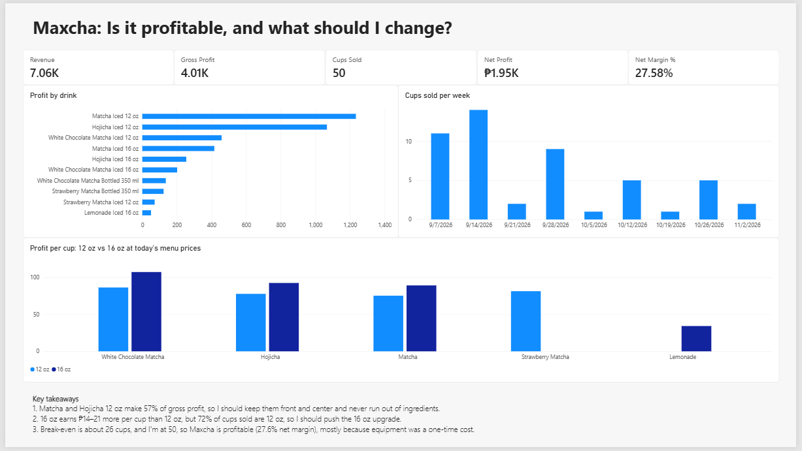

# Maxcha: unit economics and pricing analysis in PostgreSQL

**Question:** Is Maxcha profitable, and what should I change to earn more?

**Answer:** Yes. In 9 weeks Maxcha earned ₱1,947.50 in net profit (a 27.6% net margin) and passed break-even at about 26 cups, after selling 50. To earn more, I should push the 16 oz upgrade and keep my two best sellers, Matcha and Hojicha 12 oz, always in stock.



*Power BI dashboard built on the SQL views in this repo. PDF version: [dashboard/maxcha_dashboard.pdf](dashboard/maxcha_dashboard.pdf).*

## What I did

Maxcha is my small home-based matcha drink business. I took my own sales, recipes and expenses (previously scattered across Excel tabs), rebuilt them as a normalized PostgreSQL database, and used SQL to answer seven business questions. Each question ends in a decision. I then built a Power BI dashboard on top of the SQL views.

**Data:** 38 orders, 50 cups, 10 drinks, 7 Sep to 2 Nov 2026.

## Key findings

| # | Question | Finding | Decision |
|---|----------|---------|----------|
| Q1 | Which drinks make the most profit? | Matcha and Hojicha 12 oz make about 57% of gross profit. 5 of 10 drinks sold only 1–2 cups. | Keep them front and center, never run out of ingredients. |
| Q2 | Is 16 oz worth pushing? | At today's menu prices, 16 oz earns ₱14–21 more per cup than 12 oz at a margin only 1–2 points lower. 72% of cups sold are 12 oz. | Push the 16 oz upgrade. |
| Q3 | Do add-ons help? | Add-on cups earn ₱87.22 profit per cup vs ₱77.51 without. | Offer add-ons more often. |
| Q4 | Break-even? | Average profit ₱80.23 per cup, operating expenses ₱2,064, so break-even is about 25.7 cups. I sold 50. | Treat about 26 cups as the cost-cover target. |
| Q5 | What drives the cost of my best seller? | In Matcha Iced 12 oz (₱53.70 per cup), matcha powder is 56% of ingredient cost. | Compare matcha powder suppliers first. |
| Q6 | How does demand change over time? | First 4 weeks sold 36 of 50 cups. Low weeks match weeks I was busy. | Keep a steady selling routine. |
| Q7 | Profitable after all expenses? | Revenue ₱7,062, net profit ₱1,947.50, margin 27.6%. Equipment is 71% of operating expenses. | Track margin again once equipment spending stops. |

Full write-ups with the numbers are in [findings.md](findings.md).

## How I built this

1. **Cleaned and modelled the data** in PostgreSQL: customers, ingredients, drinks, recipe items, add-ons, orders, order add-ons and expenses.
2. **Costed every recipe.** The `drink_cost` view sums each recipe's ingredient quantities times unit cost, plus 5% wastage.
3. **Built an `order_lines` view** with revenue, cost of goods sold (COGS) and gross profit per order, including add-ons.
4. **Answered each question in SQL** using joins, aggregates, subqueries, CTEs and `DATE_TRUNC` for weekly trends.
5. **Checked my work.** Totals in the database (38 orders, 50 cups, ₱7,062 revenue) match my original Excel workbook, and COGS differs by ₱24.45 (under 1%).
6. **Built a Power BI dashboard** connected directly to the PostgreSQL views, with DAX measures for operating expenses, net profit and net margin.

**Tools:** PostgreSQL 18, DBeaver, Power BI Desktop.

## Data and definitions

| Term | Definition |
|------|------------|
| Revenue | Price charged per cup plus add-ons |
| COGS | Ingredient and packaging cost per cup, plus 5% wastage |
| Gross profit | Revenue minus COGS |
| Operating expenses | Equipment (₱1,463) + R&D (₱290) + Marketing (₱183) + Delivery fees (₱128) = ₱2,064 |
| Net profit | Gross profit minus operating expenses (₱4,011.50 − ₱2,064 = ₱1,947.50) |
| Net margin | Net profit divided by revenue |

**Why restocks are not in operating expenses:** ingredient and packaging restocks (₱6,504) are already counted through COGS. Counting them again would double count them. Cash spent on restocks is not the same as profit.

## Caveats

- **Small sample.** 50 cups over 9 weeks, and half of the drinks sold only 1–2 cups, so those results are guesses, not trends.
- **Old prices in the sales data.** Some sales were made at earlier prices (for example, Strawberry Matcha 12 oz sold at ₱129 vs a ₱139 menu price). Q2 uses today's menu prices as a what-if.
- **Add-on comparison is not perfectly fair.** Profit per cup includes add-on revenue, and add-on cups may be larger drinks.
- **Q5 covers one drink only** (Matcha Iced 12 oz).
- **Weekly data is short.** Only 9 weeks, and one week is a single order from a relative.
- **Equipment is mostly one-time**, so the 27.6% net margin understates what ongoing months may look like.
- **Small mismatch with my old workbook:** COGS differs by ₱24.45 (under 1%).
- **Customer type was unreliable** in my original data, so I left it out of the analysis.

## Files

```text
sql/maxcha_queries.sql      views, checks and all queries (Q1–Q7)
data/recipe_items.csv       recipe quantities per drink (97 rows)
dashboard/                  dashboard screenshot and PDF
findings.md                 findings and decisions for each question
```

**Privacy:** raw order data is not included because it contains customer information. Customers appear only as anonymized IDs.